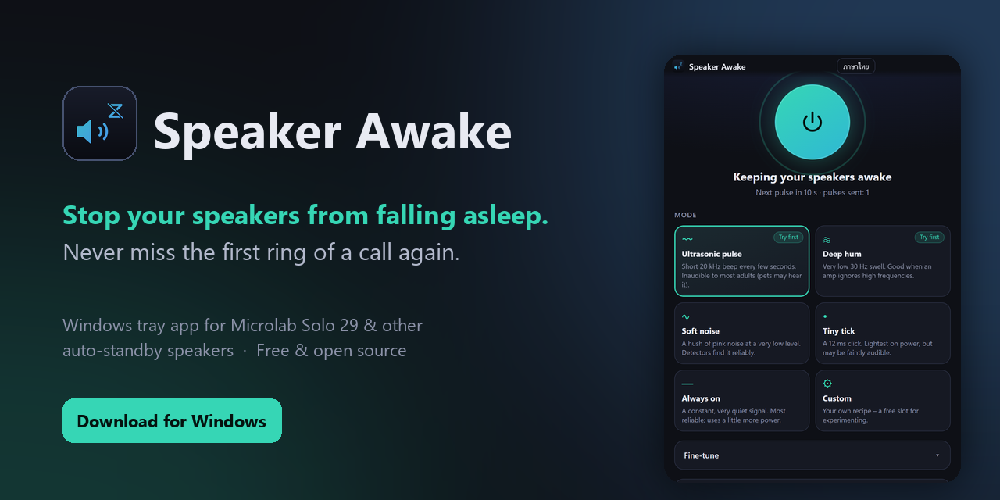
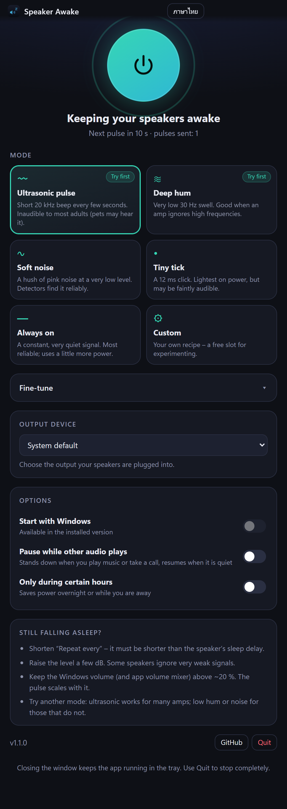
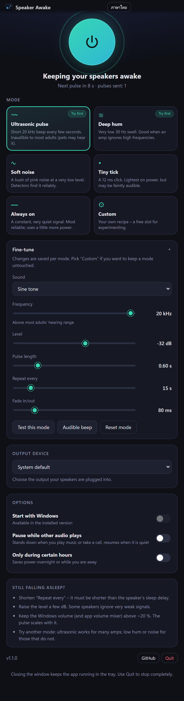
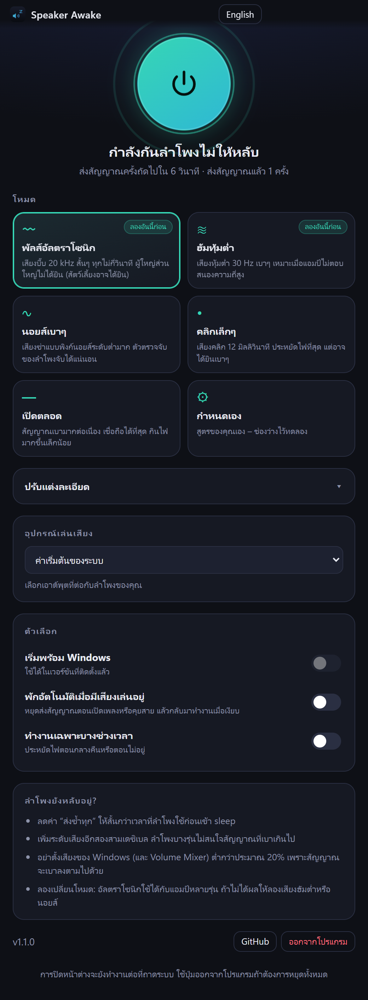

<div align="center">



# Speaker Awake

**Stop auto-standby speakers from falling asleep, so you never miss the first ring of a call.**<br>
Built for the **Microlab Solo 29**, works with any speaker that goes to sleep when it's quiet.

[](https://github.com/Kensukeimagery/speaker-awake/releases/latest)
[](https://github.com/Kensukeimagery/speaker-awake/releases)
[](LICENSE)


**English** · [ภาษาไทย](#ภาษาไทย)

</div>

## The problem

Many desktop speakers (Microlab Solo series, Edifier, Logitech, Creative and others) switch to standby after a few minutes of silence. When a call comes in, the speaker needs a moment to wake up and **the first ring is lost** – or you miss the call completely.

## What Speaker Awake does

It lives in your system tray and plays a tiny signal at a chosen interval, so the speaker's silence detector never sees "silence". The default is an **ultrasonic 20 kHz pulse** that most adults can't hear.

- **6 modes** – ultrasonic pulse, deep hum, soft noise, tiny tick, always-on, custom
- **Fine-tune everything** – frequency, level (dB), pulse length, repeat interval, fade, per mode
- **Pick the output device** – target just your speakers
- **Schedule** – only run during chosen hours (overnight ranges work)
- **Smart pause** – stands down while music or a call is playing and resumes when it's quiet again (optional)
- **Starts with Windows** – quietly in the background or with the window open, your choice (optional)
- **Thai / English interface**
- Free, open source, no account, no network access, no telemetry

<div align="center">

&nbsp;&nbsp;

</div>

## Install

1. Download **`SpeakerAwake-Setup-x.y.z.exe`** from the [latest release](https://github.com/Kensukeimagery/speaker-awake/releases/latest).
2. Run it (Windows 10/11, 64-bit). It installs per-user, no admin rights needed.
3. Pick a mode and press the big button. Closing the window keeps it running in the tray.

> Windows SmartScreen may warn because the installer isn't code-signed. Choose **More info → Run anyway**, or [build it yourself](#build-from-source).

## Modes

| Mode | What it plays | Good for |
|---|---|---|
| Ultrasonic pulse | 20 kHz beep, 0.6 s every 15 s | Most speakers. Inaudible to most adults. |
| Deep hum | 30 Hz swell | Amps that ignore high frequencies |
| Soft noise | Very quiet pink noise | Detectors that need "real" audio |
| Tiny tick | 12 ms click | Lowest power, may be faintly audible |
| Always on | Constant very quiet 20 kHz | Most reliable, slightly more power |
| Custom | Your own recipe | Experimenting |

## Tuning for your speakers

A speaker's sleep timer can't be read, so settings are found by trial:

1. Start with *Ultrasonic pulse*. Let the speakers sit idle longer than their sleep delay and see if they still sleep.
2. Still sleeping? Shorten **Repeat every**, then raise **Level** by 3–6 dB.
3. Still no luck? Try *Deep hum* or *Soft noise*, then *Always on*.
4. Keep the Windows volume (and the app's volume in the mixer) above about 20 %: the pulse is scaled by it.

Use **Audible beep** in the Fine-tune panel to confirm the right output device is selected.

## Tested speakers

Help fill this in with a [speaker report](https://github.com/Kensukeimagery/speaker-awake/issues/new?template=speaker-report.yml).

| Speaker | Connection | Mode & settings | Result |
|---|---|---|---|
| Microlab Solo 29 | 3.5 mm | Ultrasonic 20 kHz, −32 dB, 15 s *(default)* | ⏳ awaiting confirmation |

## FAQ

**Will I hear it?** The default 20 kHz pulse is above most adults' hearing range. Very sensitive speakers may emit a faint hiss; lower the level or use another mode. Pets can hear 20 kHz.

**Does it use a lot of CPU or power?** No. It plays a short buffer every few seconds. Always-on mode keeps the audio device active and uses slightly more power.

**My speaker still goes to sleep.** See [Tuning](#tuning-for-your-speakers). Some speakers only respond to audible-range signals; try *Soft noise*.

**Does it work with Bluetooth / USB / HDMI speakers?** Any output Windows can play to. Pick it under *Output device*. Devices that sleep inside the digital link (some HDMI monitors) may behave differently, so please report results.

**What does "Pause while other audio plays" listen to?** The sound Windows is playing to the default output device (a loopback of the mix, never the microphone). The level is only measured on your PC; nothing is recorded or sent. It isn't available in *Always on* mode, where the app's own signal can't be told apart from other audio.

**Does it stop the PC from sleeping?** No. It only keeps the *speakers* awake.

**Is it safe?** Source code is here, MIT licensed. The app makes no network connections; the GitHub button just opens your browser.

## Build from source

Needs Node.js 20+ (Python + Pillow only to regenerate icons/banner).

```bash
npm install
npm test        # signal-generation unit tests
npm start       # run in development
npm run dist    # builds dist/SpeakerAwake-Setup-<version>.exe
```

Tip: building the installer from a very deep folder path can fail inside NSIS. Use a short path such as `C:\dev\speaker-awake`.

Release: `git tag v1.x.y && git push --tags`. The workflow in `.github/workflows/release.yml` builds the installer and attaches it to a GitHub release.

## Contributing

Speaker reports are the most useful contribution – see [CONTRIBUTING.md](CONTRIBUTING.md). If this saved you a missed call, a ⭐ helps other people find it.

## License

[MIT](LICENSE)

<sub>Keywords: Microlab Solo 29 sleep, speaker auto standby, speaker auto power off, keep speakers awake, stop speaker going to sleep, speaker misses first ring, anti-sleep speaker Windows, ultrasonic keep-alive.</sub>

---

<a id="ภาษาไทย"></a>

# ภาษาไทย

<div align="center">

**กันลำโพงไม่ให้หลับ จะได้ไม่พลาดสายโทรเข้า**<br>
ทำมาสำหรับ **Microlab Solo 29** ใช้ได้กับลำโพงทุกรุ่นที่เข้าโหมดหลับเองเมื่อเงียบ

</div>

## ปัญหา

ลำโพงตั้งโต๊ะหลายรุ่น (Microlab Solo, Edifier, Logitech, Creative ฯลฯ) จะเข้าโหมดสแตนด์บายเมื่อเงียบไปสักพัก พอมีสายเข้า ลำโพงต้องใช้เวลาตื่น **เสียงเรียกแรกจึงหายไป** หรือพลาดสายไปเลย

## โปรแกรมทำอะไร

อยู่ที่ถาดระบบ (system tray) และส่งสัญญาณเสียงเล็กๆ เป็นช่วงๆ เพื่อไม่ให้ลำโพงเห็นว่า "เงียบ" ค่าเริ่มต้นคือ **พัลส์อัลตราโซนิก 20 kHz** ที่ผู้ใหญ่ส่วนใหญ่ไม่ได้ยิน

- **6 โหมด** – พัลส์อัลตราโซนิก ฮัมทุ้มต่ำ นอยส์เบาๆ คลิกเล็กๆ เปิดตลอด กำหนดเอง
- **ปรับละเอียดได้ทุกอย่าง** – ความถี่ ระดับเสียง (dB) ความยาว ช่วงส่งซ้ำ การเฟด แยกตามโหมด
- **เลือกอุปกรณ์เล่นเสียง** ให้ตรงกับลำโพง
- **ตั้งเวลา** ทำงานเฉพาะบางช่วง (ข้ามคืนได้)
- **พักอัตโนมัติเมื่อมีเสียงเล่นอยู่** – หยุดส่งสัญญาณตอนเปิดเพลงหรือคุยสาย แล้วกลับมาเองเมื่อเงียบ (ตัวเลือก)
- **เปิดเองหลังเปิดเครื่อง** – เลือกได้ว่าให้ทำงานเบื้องหลังเงียบๆ หรือเด้งหน้าต่างขึ้นมา (ตัวเลือก)
- หน้าต่างภาษาไทย/อังกฤษ
- ฟรี โอเพนซอร์ส ไม่ต้องสมัครบัญชี ไม่เชื่อมต่ออินเทอร์เน็ต ไม่เก็บข้อมูล

<div align="center">

</div>

## ติดตั้ง

1. ดาวน์โหลด **`SpeakerAwake-Setup-x.y.z.exe`** จาก[หน้า Releases ล่าสุด](https://github.com/Kensukeimagery/speaker-awake/releases/latest)
2. ดับเบิลคลิกเพื่อติดตั้ง (Windows 10/11 แบบ 64 บิต ไม่ต้องใช้สิทธิ์ผู้ดูแลระบบ)
3. เลือกโหมด แล้วกดปุ่มกลมใหญ่ ปิดหน้าต่างแล้วโปรแกรมยังทำงานต่อที่ถาดระบบ

> Windows SmartScreen อาจเตือน เพราะตัวติดตั้งยังไม่ได้เซ็นรับรอง กด **ข้อมูลเพิ่มเติม → เรียกใช้อยู่ดี** หรือสร้างจากซอร์สโค้ดเอง

## โหมด

- **พัลส์อัลตราโซนิก** – บี๊บ 20 kHz 0.6 วินาที ทุก 15 วินาที เหมาะกับลำโพงส่วนใหญ่ ผู้ใหญ่ส่วนใหญ่ไม่ได้ยิน
- **ฮัมทุ้มต่ำ** – เสียงทุ้ม 30 Hz สำหรับแอมป์ที่ไม่ตอบสนองความถี่สูง
- **นอยส์เบาๆ** – พิงก์นอยส์ระดับต่ำมาก สำหรับตัวตรวจจับที่ต้องการเสียงจริง
- **คลิกเล็กๆ** – คลิก 12 มิลลิวินาที ประหยัดไฟที่สุด แต่อาจได้ยินเบาๆ
- **เปิดตลอด** – สัญญาณเบามากต่อเนื่อง เชื่อถือได้ที่สุด กินไฟเพิ่มเล็กน้อย
- **กำหนดเอง** – สูตรของคุณเอง

## วิธีหาค่าที่เหมาะกับลำโพงของคุณ

โปรแกรมอ่านเวลา sleep ของลำโพงไม่ได้ จึงต้องลองปรับดู:

1. เริ่มที่ *พัลส์อัลตราโซนิก* ปล่อยให้เงียบนานกว่าเวลา sleep ของลำโพงแล้วดูว่าหลับหรือไม่
2. ถ้ายังหลับ ลดค่า **ส่งซ้ำทุก** ให้สั้นลง แล้วเพิ่ม **ระดับเสียง** ทีละ 3–6 dB
3. ถ้ายังไม่ได้ผล ลอง *ฮัมทุ้มต่ำ* หรือ *นอยส์เบาๆ* แล้วค่อยลอง *เปิดตลอด*
4. อย่าตั้งเสียง Windows (และ Volume Mixer ของแอป) ต่ำกว่าประมาณ 20% เพราะสัญญาณจะเบาลงตาม

ปุ่ม **เสียงบี๊บทดสอบ** ช่วยเช็กว่าเลือกอุปกรณ์เล่นเสียงถูกตัว

## คำถามที่พบบ่อย

**จะได้ยินเสียงไหม?** พัลส์ 20 kHz สูงกว่าช่วงที่ผู้ใหญ่ส่วนใหญ่ได้ยิน ลำโพงที่ไวมากอาจมีเสียงซ่าเบาๆ ให้ลดระดับเสียงหรือเปลี่ยนโหมด สัตว์เลี้ยงอาจได้ยิน

**กินไฟหรือ CPU มากไหม?** ไม่มาก โหมดเปิดตลอดจะกินไฟมากขึ้นเล็กน้อย

**ใช้กับลำโพง USB / Bluetooth / HDMI ได้ไหม?** ได้กับเอาต์พุตที่ Windows เล่นเสียงออกได้ เลือกใน "อุปกรณ์เล่นเสียง" ถ้าใช้ได้หรือไม่ได้ บอกเราผ่าน[แบบฟอร์มรายงานลำโพง](https://github.com/Kensukeimagery/speaker-awake/issues/new?template=speaker-report.yml)

**"พักอัตโนมัติเมื่อมีเสียงเล่นอยู่" ฟังอะไร?** ฟังเสียงที่ Windows เล่นออกอุปกรณ์เริ่มต้น (ไม่ใช่ไมโครโฟน) วัดระดับในเครื่องเท่านั้น ไม่อัดเสียงและไม่ส่งไปที่ไหน ใช้ไม่ได้ในโหมด *เปิดตลอด* เพราะแยกสัญญาณของโปรแกรมออกจากเสียงอื่นไม่ได้

**ทำให้คอมไม่หลับด้วยไหม?** ไม่ กันเฉพาะ *ลำโพง* ไม่ให้หลับ

## สร้างจากซอร์สโค้ด

ต้องมี Node.js 20 ขึ้นไป

```bash
npm install
npm test
npm start
npm run dist
```

ถ้าสร้างตัวติดตั้งแล้วเจอ error จาก NSIS ให้ย้ายโปรเจกต์ไปไว้ในโฟลเดอร์ที่พาธสั้นๆ เช่น `C:\dev\speaker-awake`

## สัญญาอนุญาต

[MIT](LICENSE)

<sub>คำค้นหา: Microlab Solo 29 ลำโพงหลับ, ลำโพงดับเอง, ลำโพงสแตนด์บาย, กันลำโพงหลับ, ลำโพงไม่ดังตอนสายเข้า, ลำโพง auto sleep</sub>
